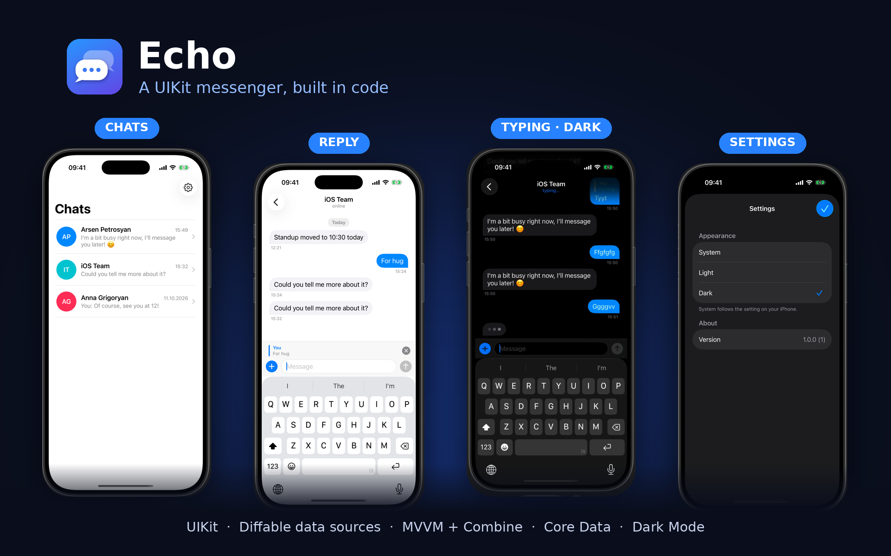
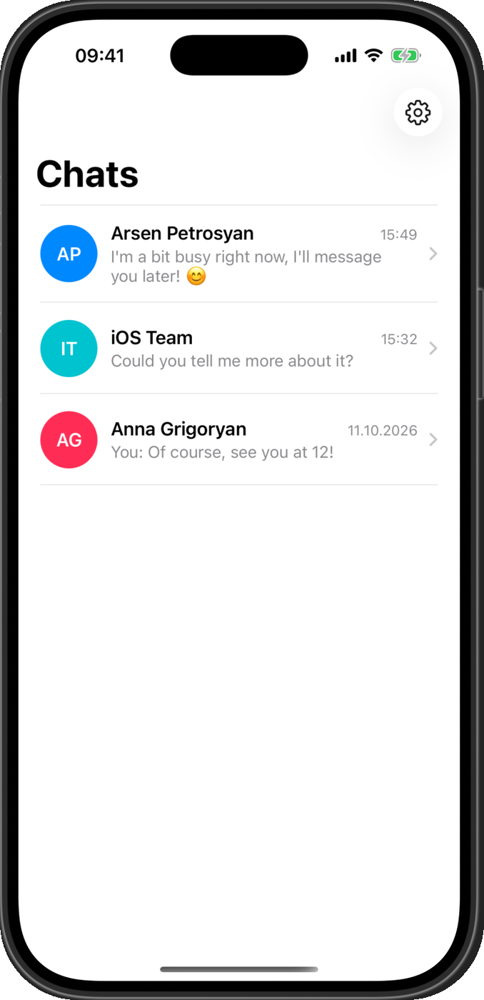
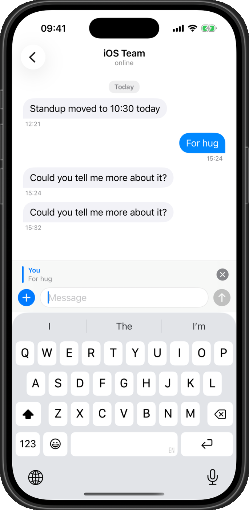
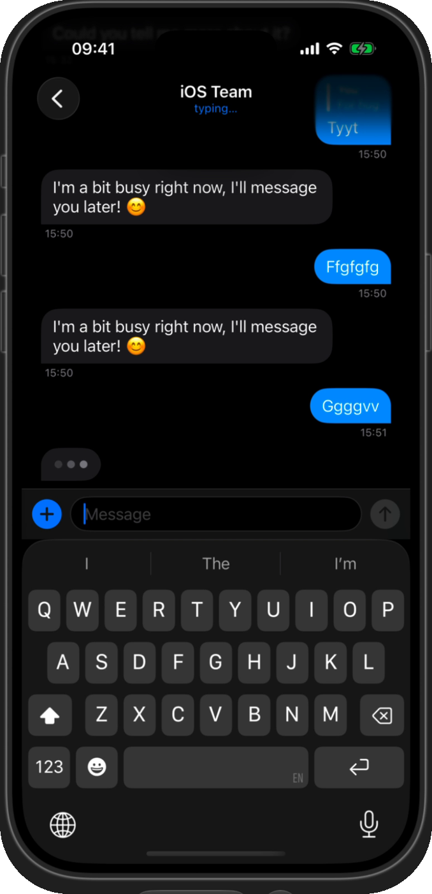
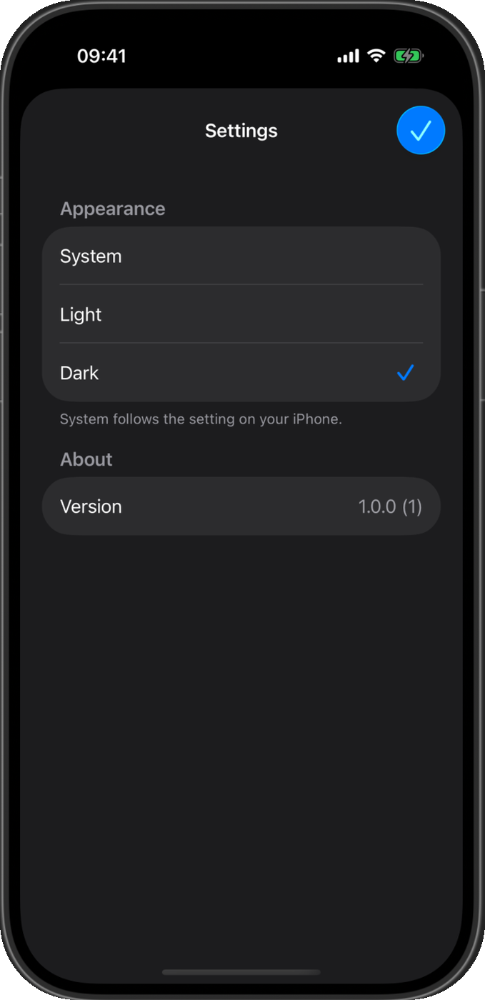
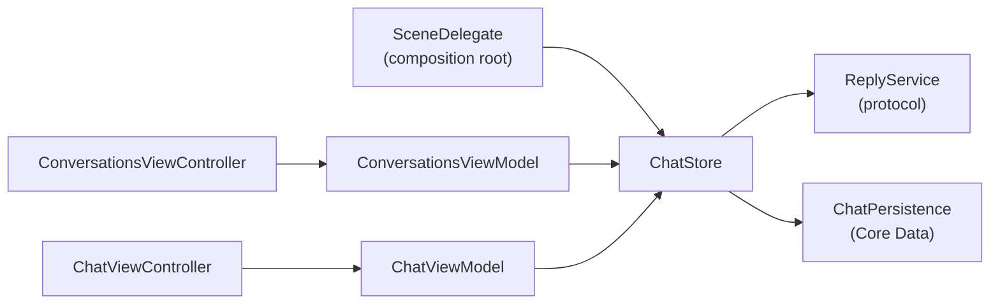

<p align="center">
  
</p>

<h1 align="center">Echo</h1>

<p align="center">
  A messenger for iPhone built entirely in UIKit, in code: no storyboards, diffable data sources, MVVM with Combine, Core Data, and a composer that rides on the keyboard.
</p>

<p align="center">
  
  
  
  
  
  
  
</p>

---

<p align="center">
  
</p>

## Screenshots

| Chats | Reply | Typing · Dark | Settings |
|:--:|:--:|:--:|:--:|
|  |  |  |  |

## Demo

<!-- Drag echo-demo.mp4 here in the GitHub editor; GitHub turns it into a video player. -->

## Features

- **Chat list** — every conversation with an avatar, a preview ("You: See you at 12!", "📷 Photo") and a time. The list re-sorts with an animation when a new message arrives, and shows "typing…" live.
- **Conversations grouped by day** — "Today", "Yesterday", then dates, in floating pills between days.
- **Text and photo bubbles** — blue on the right for you, gray on the left for them. Photos are picked with `PHPickerViewController` and open full screen with pinch and double-tap zoom.
- **A real composer** — the input bar is the screen's `inputAccessoryView`: it stays at the bottom, rides up with the keyboard, grows with the text up to five lines, and can be dismissed interactively by dragging the chat.
- **Reply, Copy, Delete** — long-press a bubble: it lifts out of the list with a context menu. Replies quote the original above the composer and inside the new bubble, like Telegram or iMessage.
- **"typing…"** — three pulsing dots in a bubble at the bottom of the chat, and "typing…" under the contact's name, while a reply is on its way.
- **Saved on device** — conversations, photos and replies are stored with Core Data and are still there after a relaunch.
- **Appearance setting** — the ⚙️ button opens Settings, where you pick System, Light or Dark. The choice is saved and applied to the whole window, sheets and the photo viewer included.
- **Dark Mode and Dynamic Type** — semantic colors everywhere and fonts that scale with the user's text size. VoiceOver reads each bubble as "Arsen, 14:05, Ready for the release?".

Replies come from a local `ReplyService`, so the app works without a backend. Swapping in a real server only means another implementation of that protocol.

## Architecture



| Layer | Types | Responsibility |
|---|---|---|
| Models | `Contact`, `Conversation`, `Message`, `MessageContent` | Plain values. A photo is compared by ID, so messages stay cheap to diff. |
| Persistence | `ChatPersistence`, `CoreDataChatPersistence` | Core Data behind a protocol. The model is defined in code, photos are stored as external binary data, and an in-memory store powers the tests. |
| Store | `ChatStore` | The single source of truth, `@Published` for Combine. Sending adds and saves your message at once and returns a `Task` for the reply. |
| Logic | `MessageGrouping`, `ChatFormat` | Pure functions: days and their titles, times, list previews and VoiceOver labels. |
| View models | `ConversationsViewModel`, `ChatViewModel` | Turn the store into rows and day sections; trim and validate what you send. |
| UI | `ConversationsViewController`, `ChatViewController`, `MessageCell`, `TypingIndicatorCell`, `ChatInputBar`, `ImageViewerController` | UIKit in code, with `UITableViewDiffableDataSource`. |

### Key decisions

- **One store, many screens.** The list and an open chat observe the same `ChatStore`, so a reply updates the chat, the list preview and the list order together, with no notifications to keep in sync.
- **Diffable data sources keyed by ID.** The table holds message IDs, not messages, and cells look the message up in the view model. New messages animate in; nothing reloads the whole table.
- **Persistence behind a protocol.** `ChatStore` only knows `ChatPersistence`, so Core Data could be swapped for a server or SwiftData without touching a screen. If the database can't open, the app keeps working in memory instead of crashing.
- **Quotes are snapshots.** A reply stores a copy of what it answers, so it still reads correctly after the original is deleted.
- **Testable time.** The store takes a clock and a `sleep` function, so the 1.5-second "typing…" delay takes no time in tests and every date is fixed.
- **No storyboards.** The scene delegate builds the window, and every view lays itself out with Auto Layout anchors.

## Requirements

- Xcode 16 or later, iOS 17 or later
- [XcodeGen](https://github.com/yonaskolb/XcodeGen) (`brew install xcodegen`)

## Getting started

```bash
git clone https://github.com/Irenapoghosian/echo-chat.git
cd echo-chat
xcodegen
open Echo.xcodeproj
```

Press **⌘R** to run, or **⌘U** to run the tests.

## Testing

**34 unit tests**, run on every push by GitHub Actions together with SwiftLint in strict mode. The coverage badge counts logic files only; UIKit views and controllers are checked by running the app.

- `MessageGroupingTests` — grouping by day, "Today" / "Yesterday" / date titles.
- `ChatFormatTests` — times, list timestamps, previews, VoiceOver labels, initials, photo proportions.
- `ChatStoreTests` — sending, the typing state and the reply, photo replies.
- `PersistenceTests` — round trips with an in-memory Core Data store: order, deletes, photos, replies, and seeding the first launch.
- `AppearanceTests` — the default, saving and applying the choice.
- `ViewModelTests` — replying, cancelling and deleting, trimming and blank messages, day sections, list order, "typing…" previews.

## Author

**Irena Poghosyan** — iOS developer · [GitHub](https://github.com/Irenapoghosian)

## License

MIT. See [LICENSE](LICENSE).
